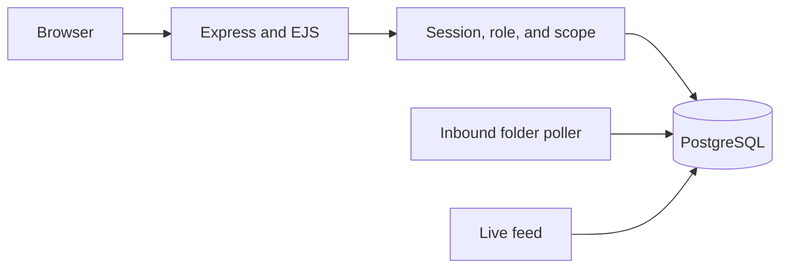
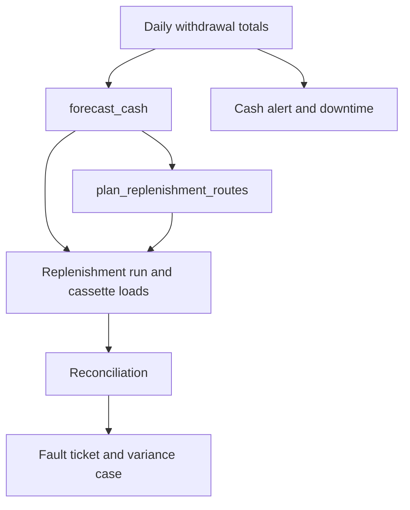

# Project Blueprint

ATM Cash Operations is a server-rendered ledger for replenishing ATM cash and watching downtime. This blueprint describes the application as it is built in this repository: the Express pages, the PostgreSQL schema in `db/schema.sql`, and the sample fleet loaded by `db/seed.js` when the database is empty.

## Contents

1. [Problem statement](#1-problem-statement)
2. [Objectives](#2-objectives)
3. [Scope](#3-scope)
4. [Out of scope](#4-out-of-scope)
5. [Stakeholders and roles](#5-stakeholders-and-roles)
6. [Access matrix](#6-access-matrix)
7. [Functional modules](#7-functional-modules)
8. [Architecture](#8-architecture)
9. [Data flow](#9-data-flow)
10. [Success metrics](#10-success-metrics)

## 1. Problem statement

A cash-management operation that services bank ATMs has to decide, each day, which machines will run short, how much of each denomination to load, which van and custodian will make the trip, and whether the cash counted afterwards matches the books. The same operation has to see which machines are down, why, and whether the fault was handled inside a time target.

Doing that from separate spreadsheets loses the link between a forecast, a cassette load, a reconciliation difference, and the fault ticket that difference should raise. This application keeps those records in one PostgreSQL ledger and shows each person only the ATMs their role is allowed to see.

The sample ledger, loaded only when `app_meta` has no `seeded` row, contains 10 locations, 50 branches, 450 ATMs (45 in each location, 9 in each branch), 20 cash vans, 30 custodians, and 20 engineers, with 63 days of withdrawal totals. Those figures describe the demonstration data, not a live bank.

## 2. Objectives

- Show month-to-date availability, open faults, and cash pressure for the ATMs in the signed-in user's area.
- Forecast one ATM-day as the same-weekday average of the previous 28 days, multiplied by salary-day, month-end, and holiday factors.
- Suggest note counts for the ₹500, ₹200, and ₹100 cassettes, and let an operator save a run whose total is denomination times note count.
- Plan replenishment runs for ATMs whose forecast exceeds cash still in the machine, grouped onto a van and custodian.
- Record a reconciliation and, when the count differs from the expected amount, raise a variance case and a fault ticket.
- Track downtime windows, month-to-date uptime, and SLA response and resolution hours.
- Accept a daily bank file (uploaded, pasted, or dropped in a folder) and raise cash alerts, fault tickets, and downtime from optional columns on that file.
- Keep an append-only activity log of sign-ins, pages opened, and field changes.
- Enforce six roles, and limit regional, branch, custodian, and engineer users to their own area.

## 3. Scope

The running application includes:

- Sign-in, first-run Super Admin setup, sessions, and role checks on every page except `/login`, `/setup` (when it is open), and `/health`.
- The pages listed under [Functional modules](#7-functional-modules), rendered with EJS.
- The PostgreSQL tables, views, functions, the `plan_replenishment_routes` procedure, and the reconciliation and audit triggers in `db/schema.sql`.
- A sample fleet for demonstration, created once on an empty database.
- An Oracle PL/SQL reference in `oracle/` that is not executed by the Node process.
- A host script, `scripts/archive_ej_logs.sh`, described on the Electronic Journal Archive page. The web process does not run it.

Amounts are Indian rupees. The session time zone is `Asia/Kolkata`. Denominations accepted on a cassette row are 100, 200, 500, and 2000.

## 4. Out of scope

- The application does not connect to an ATM, a core-banking system, or an ISO 8583 switch. A bank file here is a daily total per ATM.
- It does not move cash, dispatch a van, or close a downtime window from a button. Open downtime is a review list. Windows are opened and closed by the feed rules.
- The live feed is an in-process demonstration. It does not start on its own, and the Fleet Uptime page says it stops itself after 15 minutes.
- The Electronic Journal Archive page documents a shell script. The server does not shell out to it.
- The Oracle scripts are a reference port. The application never connects to Oracle.
- There is no self-service password reset by email. A Super Admin sets passwords on User Accounts.
- There is no native mobile application. Pages are server-rendered and usable on a narrow screen.
- The permission `editOwnDowntime` is granted to the Engineer role, but no page writes a downtime row for that permission.

## 5. Stakeholders and roles

The ledger is operated by a cash-management team. The signed-in roles, stored on `users.role` and labelled on screen, are:

| Screen label | Role value | Area |
| --- | --- | --- |
| Super Admin | `super_admin` | Every location |
| Regional Manager | `regional_manager` | The user's `region` |
| Branch Manager | `branch_manager` | The user's `branch_id` |
| Cash Officer | `clerk` | The user's `branch_id` |
| Custodian | `custodian` | Runs where `custodian_id` is theirs, and ATMs that appear on those runs |
| Engineer | `engineer` | ATMs that already have a fault ticket assigned to their `engineer_id` |

The Engineer role is the field engineer who can be assigned on Fault Tickets. The `engineers` table stores name, phone, location, and a specialty of hardware, network, cash handling, or general. That table is the crew list. The `users` row is the sign-in account, linked by `engineer_id`.

A Regional Manager's lists are limited to one region. A Branch Manager or Cash Officer is limited to one branch, not to every branch in the same city. A Custodian does not see Cash Forecast, Fault Tickets, or reports. An Engineer does not see replenishment runs.

## 6. Access matrix

"Own area" means the scope in the table above. A blank cell is denied: the page returns Access Denied, or the control is not shown.

| Capability | Super Admin | Regional Manager | Branch Manager | Cash Officer | Custodian | Engineer |
| --- | --- | --- | --- | --- | --- | --- |
| Uptime Dashboard, ATMs | All | Own region | Own branch | Own branch | Own runs | Own tickets |
| Fault Tickets | All | Own region, can assign | Own branch, can assign | Own branch, cannot assign | — | Own tickets |
| Cash Alerts | All | Own area | Own area | Own area | Own area | Own area |
| Open Downtime | All | Own area | Own area | Own area | — | Own area |
| Cash Forecast, Forecast Accuracy | All | Own area | Own area | Own area | — | — |
| Holiday Calendar | Yes | — | — | — | — | — |
| Replenishment Runs | All | Own area | Own area | Own area | Own runs | — |
| Plan Routes, Delete Run | Yes | Yes | Yes | — | — | — |
| Approve Run | Yes | Yes | — | — | — | — |
| Reconciliation, add a case note | All | Own area | Own area | Own area | — | — |
| Resolve or write off a case | Yes | Yes | Yes | — | — | — |
| Bank Data Import, Import History | All | Own area | — | — | — | — |
| Reports, including SLA | All | Own area | Own area | Own area | — | — |
| Edit SLA targets | Yes | — | — | — | — | — |
| Electronic Journal Archive | Yes | Yes | Yes | — | — | — |
| User Accounts | Yes | — | — | — | — | — |
| Activity | All regions | Own region only | — | — | — | — |
| Live Feed start and stop | Yes | — | — | — | — | — |

Creating a run, a reconciliation, or a route plan checks the ATM or location against that scope on the server. Opening a case or a run outside the area returns Access Denied, including on delete.

## 7. Functional modules

### Uptime dashboard

**Fleet Uptime** (`/`) shows fleet uptime, machines above 5% downtime, open fault tickets, cash-out or out-of-service counts, cash dispensed yesterday, and runs today. Charts cover uptime by location, downtime minutes for the last 14 days, and withdrawals by weekday for the last eight weeks. The page also lists lowest availability, latest tickets, open cash alerts, open downtime, and ATMs likely to cash out within 24 hours. Every figure is limited to the user's area.

### Cash forecasting and holiday calendar

**Cash Forecast** asks for an ATM and a date and calls `forecast_cash`. The forecast is the average withdrawal on that weekday in the previous 28 days, times `forecast_multiplier`. The multiplier is 1.20 on days 1–3 and the last two days of the month, an extra 1.15 on the last day of the month, and the active holiday multiplier when the date is in `holidays`. **Forecast Accuracy** compares forecast with actual for the last 7 or 28 days and shows the average absolute percentage error. **Holiday Calendar** is Super Admin only. Saving a holiday uses **Save Holiday**.

### Denomination and cassette planning

Each ATM has `atm_cassettes` rows for ₹500 (2,200 notes), ₹200 (2,500), and ₹100 (3,000), inserted for every ATM that does not already have them. The suggestion splits the gap between tomorrow's forecast and current cash by the ATM's historical mix, or by 50% / 30% / 20% when there is no history, and caps each denomination at cassette capacity. **New Replenishment Run** can open with that suggestion already filled in. The operator can still type ₹2,000 notes; a saved amount must equal denomination times note count.

### Replenishment runs and route planning

**Replenishment Runs** lists trips with date, location, van, custodian, status, stops, and total loaded. **Plan Routes** calls `plan_replenishment_routes` for a date and an optional location. The procedure skips an ATM that is already on a non-cancelled run that day, skips a forecast that does not exceed cash still in the machine, and skips a shortfall under 100. It fills toward four times the forecast, capped by capacity, splits the amount across ₹2,000, ₹500, ₹200, and ₹100, and keeps a run under 15 ATMs. A scoped user cannot plan a location outside their region or branch, and the procedure also receives that branch and region.

**New Run** and **Edit Replenishment Run** use **Save Run**, **Add Cassette Row**, and **Remove**. **Approve Run** is shown when the run is not approved and the user may approve. **Delete Run** asks for confirmation and is refused for a run outside the user's area. A Cash Officer cannot move a run to in progress or completed until it is approved.

### Reconciliation and variance cases

**New Reconciliation** saves expected and counted amounts. `difference` is counted minus expected. If the difference is not zero, the trigger sets the case to Raised and inserts a cash-variance fault ticket. Priority is critical when the absolute difference is at least 100,000, high when it is at least 10,000, and medium otherwise. A matching count does not open a ticket.

The case page moves Raised to Investigating, then Investigating to Resolved or Written Off. Closing requires a reason: counting error, dispense fault, fraud suspected, cassette mismatch, or other. A Cash Officer can add a note with **Add Note** but cannot close the case. **Open Case Ageing** lists open cases and their age in days.

### Downtime, SLA, and reason

**Open Downtime** lists windows in `downtime_log` that have no end time. Reasons are cash out, hardware, communication, power, cassette error, and vandalism. **Downtime by Location** shows average month-to-date downtime and the minutes this month grouped by those reasons. **Downtime Above 5%** uses the view that keeps only ATMs strictly above 5% of elapsed minutes.

**SLA Report** compares open and closed tickets with `sla_targets`. The stored targets are cash-out 2 hours to respond and 4 to resolve, hardware 4 and 8, network 4 and 8, power 4 and 12, and other 8 and 24. Communication tickets use the network target. A Super Admin can change a target with **Save**. Assigning an engineer sets the response time if it was empty. Closing sets the resolution time if it was empty.

### Bank feed, imports, and alerts

**Bank Data Import** takes a file or pasted rows and **Validate and Load**. Required columns are ATM code, date, amount, and transaction count. Optional columns can set cash level, a fault code, and whether the ATM is online. A cash level at or below the alert threshold opens one open row in `replenishment_requests` for that ATM. A fault code opens one open ticket per ATM and code. An offline row starts downtime only after the offline threshold, and a later online row closes that window. The same file is not loaded twice: the poller stores a SHA-256 in `inbound_files`. **Import History** lists batches. **Cash Alerts** lists open replenishment requests.

### Live feed

On Fleet Uptime, a Super Admin sees **Live Feed** or **Stop Live Feed**. Starting it records a change and posts demonstration rows through the same import rules. It does not start at boot. The page states that it stops itself after 15 minutes. Stopping closes live-feed downtime and resolves live-feed tickets with the note that the feed stopped.

### Electronic journal archive

**Electronic Journal Archive** explains `scripts/archive_ej_logs.sh`. The script gzip-compresses `.log`, `.ej`, and `.jrn` files, stores them under a day folder, and deletes day folders older than the retention count. The web process does not run the script.

### Reports

Besides the downtime, SLA, and ageing reports above, **Van Cash-Outs** counts each cash-out ticket once, against the van that last serviced the ATM on or before that day. **Withdrawal Matrix** shows the last eight weeks of withdrawals, one location at a time, eight of each weekday, ending yesterday.

### Activity log

**Activity** unions sign-in history, pages opened, and field changes. Times are India Standard Time to the second. Each row has an outcome of Allowed, Denied, or Failed. A failed sign-in or a lockout is Failed. A forbidden page is Denied. Export downloads a CSV. Cells that start with `=`, `+`, `-`, or `@` are prefixed with an apostrophe. Regional Managers see only rows for their region. The three log tables reject update, delete, and truncate.

## 8. Architecture

The browser posts forms. Express checks the session and the role, then reads or writes PostgreSQL. Forecasts, route planning, the variance ticket, and the audit lock are enforced in the database as well as in the routes. The folder poller and the live feed both call the same import path.

Detail is in [TECHNICAL.md](TECHNICAL.md).

## 9. Data flow

1. Withdrawal totals arrive from the sample history, a bank file, or the live feed.
2. `forecast_cash` reads the same weekday in the prior 28 days and applies the multiplier.
3. An operator plans routes or saves a run. The run stores the van, custodian, location, date, and one row per cassette.
4. After the trip, a reconciliation stores expected and counted cash. A non-zero difference becomes a Raised case and a fault ticket.
5. A manager moves the case to Investigating, then Resolved or Written Off, with a reason.
6. Optional file columns update cash, open one alert, open one ticket per fault code, and open or close downtime. Those rows appear on Fleet Uptime, Cash Alerts, Fault Tickets, and Open Downtime.

## 10. Success metrics

The application computes these figures. It does not store a separate target for fleet uptime. The SLA hours and the 5% downtime list are the numeric thresholds written in the schema and the views.

| Figure | Where it is shown | How it is calculated |
| --- | --- | --- |
| Fleet uptime | Fleet Uptime | 100 minus the average month-to-date downtime percent, clamped between 0 and 100 |
| Above 5% downtime | Fleet Uptime and Downtime Above 5% | ATMs whose merged month-to-date downtime is strictly above 5% of elapsed minutes |
| Cash-out or down | Fleet Uptime | ATMs in status cash out, plus ATMs out of service |
| Open fault tickets | Fleet Uptime | Tickets not closed, and among them the ones whose source is the reconciliation trigger |
| Dispensed yesterday | Fleet Uptime | Sum of amount and transaction count in `daily_withdrawals` for the previous calendar day |
| Runs today | Fleet Uptime | Non-cancelled runs dated today, and planned runs dated tomorrow |
| Hours left | Likely Cash-Out Within 24 Hours | Current cash divided by tomorrow's forecast, times 24. The list keeps values of 24 hours or less |
| Average error | Forecast Accuracy | Mean absolute percentage error over days whose actual amount is greater than zero, for 7 or 28 days |
| SLA breach | Fleet Uptime and SLA Report | Open ticket whose response or resolution hours exceed the target for its category |
| Case age | Open Case Ageing | Whole days since the reconciliation was created |
| Van cash-outs | Van Cash-Outs | Each cash-out ticket counted once against the last non-cancelled van visit on or before that day |
| Activity outcome | Activity | Allowed, Denied, or Failed, from the sign-in event or the access result |

All of the operational figures above are filtered by the signed-in user's region, branch, custodian, or engineer. A Super Admin sees the whole sample fleet.
