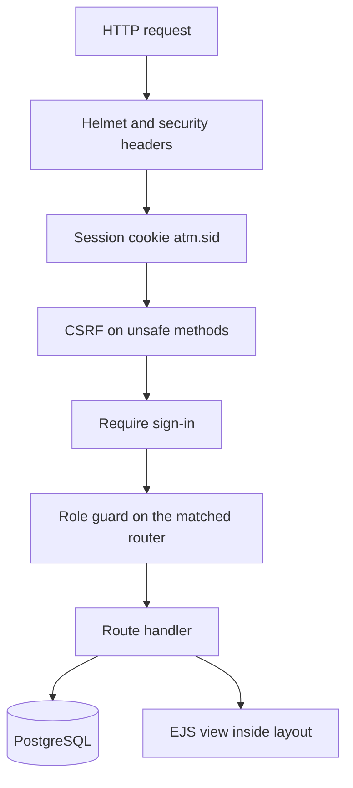
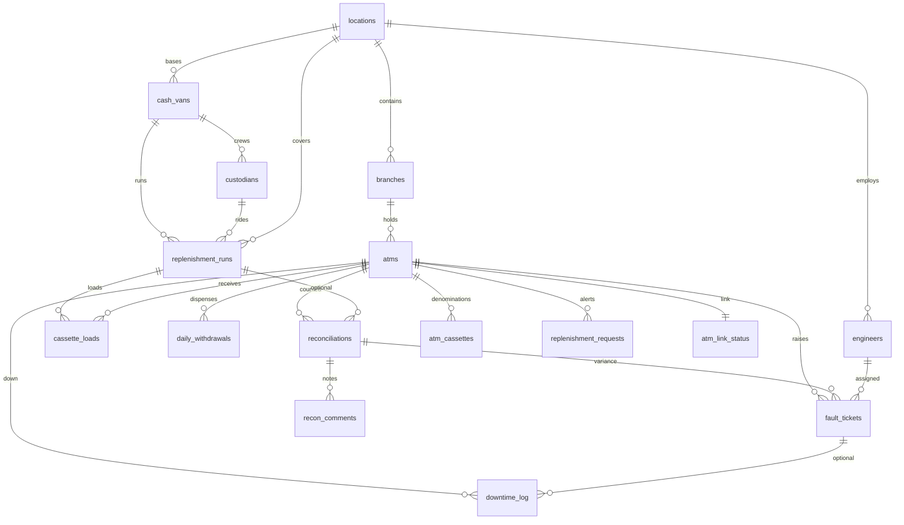
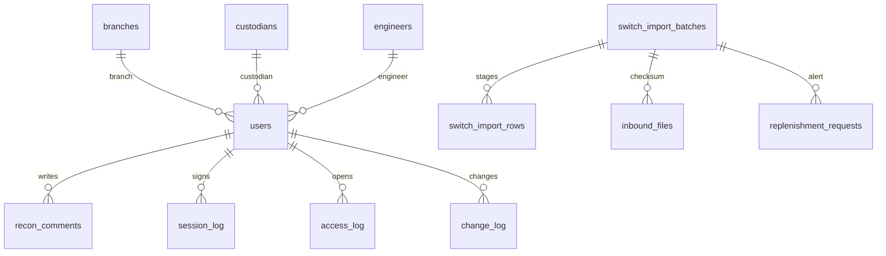

# Technical Document

This document describes the implementation in this repository. Behaviour that is not in the code, the schema, or the tests is not claimed here. Configuration names are listed without values.

## Contents

1. [Tech stack](#1-tech-stack)
2. [Repository structure](#2-repository-structure)
3. [Application architecture](#3-application-architecture)
4. [Database design](#4-database-design)
5. [Functions, procedures, and triggers](#5-functions-procedures-and-triggers)
6. [Oracle reference](#6-oracle-reference)
7. [RBAC and scope](#7-rbac-and-scope)
8. [Security](#8-security)
9. [Feed ingestion](#9-feed-ingestion)
10. [Configuration](#10-configuration)
11. [Deployment](#11-deployment)
12. [Testing](#12-testing)
13. [Known limitations](#13-known-limitations)

## 1. Tech stack

| Piece | What the repository uses |
| --- | --- |
| Runtime | Node.js 18 or newer (`package.json` engines) |
| HTTP | Express 4 |
| Pages | EJS templates in `views/` |
| Database | PostgreSQL, accessed with `pg`. The session time zone is `Asia/Kolkata` |
| Sessions | `express-session` with `connect-pg-simple` storing rows in `session` |
| Passwords | `bcryptjs` |
| Uploads | `multer`, memory storage, on Bank Data Import |
| Headers | `helmet` |
| Charts | Chart.js on Fleet Uptime and Forecast Accuracy |
| Tests | `node --test`, run one file at a time |

Numeric values from PostgreSQL are parsed as numbers. Calendar dates are returned as strings so a date is not shifted by the process time zone.

## 2. Repository structure

| Path | Role |
| --- | --- |
| `src/server.js` | Boot: schema, sample data if empty, access users, session cleanup, listen |
| `src/app.js` | Express app, helmet, static files, route mounting |
| `src/db.js` | Pool, schema apply, transactions |
| `src/http.js` | Page render, paging, money format, form fields, CSV-safe dates |
| `src/auth/` | Sign-in, passwords, grants, scope SQL, activity writes |
| `src/routes/` | One router per area, mounted at `/` |
| `src/services/` | Runs, imports, ingestion rules, forecast factors, SLA, live feed, folder poller |
| `src/lib/` | Switch-file parser, cassette-row normalizer, eight-week window |
| `views/` | EJS pages. `layout.ejs` wraps signed-in pages |
| `public/` | CSS, Chart.js, and the page scripts |
| `db/schema.sql` | Tables, views, functions, procedure, triggers. Re-applied on startup |
| `db/seed.js` | Sample fleet, only when `app_meta` has no `seeded` key |
| `oracle/` | PL/SQL reference. Not executed |
| `scripts/archive_ej_logs.sh` | Host script documented on Electronic Journal Archive |
| `test/` | Node test files |
| `render.yaml` | Render blueprint for a web service and Postgres |
| `docs/` | This set of project documents |

## 3. Application architecture

`createApp` sets the view engine, trusts one proxy hop, and disables `X-Powered-By`. `trust proxy` is 1, so the client address used in the activity log is `req.ip` after that hop, not the raw first forwarded value.

Signed-in HTML is rendered by `renderPage`: the view is rendered to a string, then placed in `layout.ejs`. The layout navigation is built from `permissionFlags`. Login, setup, and the health check do not use that layout.

Routers are mounted at `/`. A permission middleware that ran for every request would block unrelated URLs, so each router uses `guard`. The guard applies its permission only when that router matches the method and path. Otherwise it skips to the next router. Unknown URLs fall through to **Page Not Found**. A known URL without permission renders **Access Denied**.

Static files are served from `public/`. Page scripts are external files. Chart data is a `script` element of type `application/json`, which the browser does not execute. `public/js/confirm.js` listens for `submit` on forms with `data-confirm`. `public/js/login.js` toggles the password field and does not submit the form.

### Route map

| Mount | Permission | Pages |
| --- | --- | --- |
| `/` | dashboard | Fleet Uptime |
| `/atms` | atms | ATM list and detail |
| `/forecast` | forecast | Cash Forecast, Forecast Accuracy, Holiday Calendar |
| `/runs` | runs | Replenishment Runs and the run form |
| `/reconciliations` | recons | Reconciliations and variance cases |
| `/tickets` | tickets | Fault Tickets |
| `/alerts`, `/downtime` | alerts or downtime | Cash Alerts, Open Downtime |
| `/reports` | reports | Downtime, vans, matrix, SLA, case ageing |
| `/switch`, `/imports` | importData | Bank Data Import, Import History |
| `/live-feed` | liveFeed | Start, stop, and status. Only Super Admin |
| `/operations/ej-archive` | journals | Electronic Journal Archive |
| `/users` | manageUsers | User Accounts. Only Super Admin |
| `/activity` | activity | Activity and CSV export |
| `/login`, `/logout`, `/setup` | public or session | Sign-in, sign-out, first-run setup |
| `/health` | public | JSON status |

Finer checks sit on individual posts: plan, create, edit, delete, and approve for runs; create for reconciliations; assign for tickets; SLA edits and the holiday calendar for Super Admin.

## 4. Database design

`db/schema.sql` is applied on every boot. New objects use `CREATE … IF NOT EXISTS` or `ALTER … ADD COLUMN IF NOT EXISTS`. The procedure `plan_replenishment_routes` is dropped and recreated so a change in its arguments replaces the previous definition.

### Entity relationship

Operational ledger:

Access and files:

`session` stores the cookie payload and is not linked by a foreign key. `holidays` and `sla_targets` stand alone. `replenishment_plan_log` optionally points at `locations`. `app_meta` is a key-value marker (`seeded`, and `calendar_withdrawals` after the one-time history adjustment).

### Tables and key columns

| Table | Key columns | Keys and checks |
| --- | --- | --- |
| `app_meta` | `key`, `value` | Primary key `key` |
| `locations` | `location_code`, `location_name`, `city`, `state`, `region` | Unique `location_code` |
| `branches` | `location_id`, `branch_code`, `branch_name`, `address`, `ifsc_code` | Unique `branch_code`. `location_id` references `locations` |
| `atms` | `branch_id`, `atm_code`, `site_name`, `status`, `installed_on`, `cassette_count`, `capacity_amount`, `current_cash`, `last_replenished_on` | Unique `atm_code`. Status is active, cash out, out of service, or decommissioned. Cash cannot exceed capacity. Cassette count is 1 to 4 |
| `cash_vans` | `location_id`, `van_code`, `registration_no`, `capacity_amount`, `status` | Status is available, on route, or maintenance |
| `custodians` | `van_id`, `employee_code`, `full_name`, `phone`, `active` | Unique `employee_code` |
| `engineers` | `location_id`, `employee_code`, `full_name`, `phone`, `specialty`, `active` | Specialty is hardware, network, cash handling, or general |
| `replenishment_runs` | `van_id`, `custodian_id`, `location_id`, `planned_date`, `status`, `notes`, `created_by`, `approval_status`, `approved_at`, `approved_by` | Status is planned, in progress, completed, or cancelled. Approval defaults to approved so existing planner rows stay approved |
| `cassette_loads` | `run_id`, `atm_id`, `cassette_number`, `denomination`, `note_count`, `amount`, `loaded_at` | Unique run, ATM, and cassette. Denomination is 100, 200, 500, or 2000. Amount must equal denomination times note count. Deleting a run deletes its loads |
| `daily_withdrawals` | `atm_id`, `withdrawal_date`, `amount`, `txn_count`, `source` | Unique ATM and date. Source is seed, switch, or manual |
| `reconciliations` | `atm_id`, `run_id`, `recon_date`, `expected_amount`, `counted_amount`, `difference`, `case_status`, `reason_code`, `assignee_id`, `closed_by`, `closed_at`, `notes` | `difference` is generated as counted minus expected. `run_id` is set null if the run is deleted |
| `recon_comments` | `reconciliation_id`, `user_id`, `body`, `created_at` | Deleted with the reconciliation |
| `fault_tickets` | `ticket_no`, `atm_id`, `reconciliation_id`, `engineer_id`, `title`, `category`, `priority`, `status`, `source`, `origin`, `fault_code`, `resolution`, `opened_at`, `assigned_at`, `responded_at`, `resolved_at`, `closed_at` | Unique `ticket_no`, shaped as `TKT-` plus six digits. Category is cash variance, cash out, hardware, communication, or cassette error. Status is open, assigned, or closed. Source is trigger, manual, or monitor |
| `downtime_log` | `atm_id`, `ticket_id`, `started_at`, `ended_at`, `reason`, `notes`, `origin` | End is null or not before the start. Reason is cash out, hardware, communication, power, cassette error, or vandalism |
| `replenishment_plan_log` | `target_date`, `location_id`, `runs_created`, `atms_assigned`, `planned_at` | One row per procedure call |
| `switch_import_batches` | `filename`, `file_format`, `source`, `content_sha256`, `row_count`, `loaded_count`, `error_count`, `replace_existing`, `status` | Format is csv or fixed. Status is loaded, loaded with errors, or rejected |
| `switch_import_rows` | `batch_id`, `line_no`, `raw_line`, `atm_code`, `txn_date`, `amount`, `txn_count`, `status`, `error_message` | Status is staged, loaded, or error. Rows are deleted with the batch |
| `inbound_files` | `filename`, `content_sha256`, `source`, `batch_id`, `received_at` | Unique SHA-256 |
| `replenishment_requests` | `atm_id`, `batch_id`, `current_cash`, `capacity_amount`, `threshold_pct`, `status`, `created_at`, `closed_at` | Status is open or closed. A partial unique index allows only one open request per ATM |
| `atm_link_status` | `atm_id`, `online`, `offline_since`, `state_as_of`, `updated_at` | Primary key is the ATM. `state_as_of` is `timestamptz` |
| `atm_cassettes` | `atm_id`, `denomination`, `capacity_notes` | Primary key ATM and denomination. Denomination is 100, 200, or 500 |
| `holidays` | `holiday_date`, `name`, `multiplier`, `active` | Unique date. Multiplier is above 0 and at most 5 |
| `sla_targets` | `category`, `response_hours`, `resolution_hours` | Category is cash out, hardware, network, power, or other |
| `users` | `username`, `full_name`, `role`, `region`, `branch_id`, `custodian_id`, `engineer_id`, `password_hash`, `active`, `failed_attempts`, `locked_until` | Unique username. `password_hash` may be null. Role is one of the six values in the access section |
| `session` | `sid`, `sess`, `expire` | Primary key `sid` |
| `session_log` | `event`, `user_id`, `username`, `role`, `ip`, `user_agent`, `session_id`, `region`, `created_at` | Event is success, failure, lockout, logout, or timeout |
| `access_log` | `user_id`, `username`, `role`, `method`, `page_name`, `path`, `record_id`, `outcome`, `status_code`, `region`, `branch_id` | Outcome is allowed or denied |
| `change_log` | `user_id`, `username`, `role`, `action`, `entity`, `entity_id`, `changes`, `region`, `branch_id` | Action is create, update, delete, approve, or reject. `changes` is JSON |

### Views

`v_atm_downtime_mtd` merges overlapping downtime in the current month, clips each window to the month, and divides the merged minutes by the minutes elapsed. The percent is clamped between 0 and 100. `v_atm_downtime_above_5pct` keeps rows strictly above 5. `v_van_cashout_incidents` counts each cash-out ticket once, against the van whose latest non-cancelled visit was on or before the day the ticket opened.

## 5. Functions, procedures, and triggers

| Object | Effect |
| --- | --- |
| `forecast_multiplier(date)` | Returns 1, then multiplies by 1.20 when the day is 1–3 or one of the last two days of the month, by an extra 1.15 on the last day, and by the highest active holiday multiplier for that date. Rounded to two decimals |
| `forecast_cash(atm_id, date)` | Average of `daily_withdrawals.amount` for the same weekday in the half-open window from 28 days before the date up to, but not including, the date. Multiplied by `forecast_multiplier`. Zero when there is no row. Raises an error if either argument is null |
| `forecast_cash_points(atm_id, date)` | The withdrawal rows that went into that average: date, amount, and transaction count |
| `sla_category(value)` | Maps cash out and hardware to themselves, communication to network, power to power, and everything else to other |
| `plan_replenishment_routes(date, location, runs, atms, branch, region)` | The last two arguments default to null. Plans ATMs in status active or cash out whose forecast exceeds current cash. Optional location, branch, and region filters are applied inside the loop. Skips ATMs already on a non-cancelled run that day, a shortfall under 100, a location with no available van, and a van with no active custodian. Splits the fill into 2000, 500, 200, and 100 notes. Reuses a planned run for the same van, date, and location while it has fewer than 15 distinct ATMs. Writes `replenishment_plan_log` |
| `fault_tickets_before_insert` | Fills `ticket_id` and `ticket_no` (`TKT-` and six digits) and `opened_at` when they are empty |
| `raise_fault_on_recon_variance` | After a reconciliation insert. If counted equals expected, it does nothing. Otherwise it sets `case_status` to raised when it was null, and inserts a cash-variance ticket with source trigger. Priority is critical at an absolute difference of 100,000 or more, high at 10,000 or more, and medium otherwise |
| `prevent_activity_mutation` | Raises an exception. Used by row triggers before update or delete, and by statement triggers before truncate, on `session_log`, `access_log`, and `change_log` |

A one-time block multiplies seeded withdrawal amounts by `forecast_multiplier` when `app_meta.calendar_withdrawals` is absent, then records that key so it does not run again.

## 6. Oracle reference

`oracle/` is not connected and is not run by the tests. `oracle/README.md` maps the files:

| File | Contents |
| --- | --- |
| `01_ddl.sql` | Tables, keys, checks, and the ticket-number sequence |
| `02_cash_ops.sql` | Package `cash_ops` with `forecast_cash` and `plan_replenishment_routes` |
| `03_trigger.sql` | The reconciliation trigger, plus the downtime and van cash-out views |

The package comment describes the same-weekday 28-day average and the planner that groups ATMs onto a van and custodian. The Node application uses the PostgreSQL objects only. The later PostgreSQL multiplier, holiday table, cassette suggestions, SLA targets, and variance-case columns are not described as part of that Oracle package.

## 7. RBAC and scope

Grants live in `src/auth/permissions.js`. Super Admin holds `*`. `permissionFlags` still forces **Live Feed** and **User Accounts** on only for `super_admin`, which matches `*` because no other role lists those actions.

`scopeBinds` returns four values: region for a Regional Manager, branch for a Branch Manager or Cash Officer, custodian for a Custodian, and engineer for an Engineer. The other positions are null. Super Admin gets four nulls, and the SQL treats null as "no filter".

`atmScopeSql` keeps an ATM when its location region matches, its branch matches, it appears on a run for that custodian, and it has a fault ticket for that engineer. `runScopeSql` is false for an engineer. For a branch user, a run is visible when one of its cassette loads is on their branch, or when it has no loads and its location contains their branch. `locationScopeSql` limits cities the same way, and for a custodian or engineer it keeps only cities that still contain an in-scope ATM.

Routes that change data use the same predicates as the read:

- Delete, edit, and approve check `runScopeSql` before writing. A missing run is reported as not found. A run that exists but is outside the area is Access Denied and is not deleted.
- `saveRun` rejects a real location or a new ATM code outside the caller's scope before it inserts or updates. ATM codes already on the run being edited are left in place so a shared run can still be saved.
- The planner checks the chosen location, then passes the caller's branch and region into `plan_replenishment_routes`.
- Reconciliation create, case detail, notes, and status changes require the ATM to be in `atmScopeSql`.
- Ticket assign and close do the same. Close also requires the engineer id when the caller is an Engineer.
- Bank Data Import marks out-of-scope ATM codes as row errors and does not load them.
- Dropdowns for runs, reconciliations, forecasts, the ATM list, and forecast accuracy are built from `loadReference` or the same scope SQL, so the lists do not include every ATM.

Detail pages return 403 when the row exists and is outside the area, and 404 when it does not exist.

## 8. Security

### Sessions

The cookie name is `atm.sid`. It is HTTP-only and `SameSite=Lax`. It is marked secure when `NODE_ENV` is production. The session is regenerated on a successful sign-in. Idle timeout and the absolute lifetime are the configured minute and hour values, or 30 minutes and 8 hours when unset. Rolling sessions extend the idle cookie. Expired rows are deleted at boot and on a 15-minute timer. Signing out, setting a password, changing a role, disabling an account, and a successful setup or recovery call delete that user's session rows.

`/login` and `/setup` send `Cache-Control: no-store`. Signed-in responses do as well.

### Passwords and lockout

Passwords are bcrypt hashes. Comparison always runs bcrypt, using a fixed hash when the account has no password or is locked, so a missing account does not return early. Five failures lock the account for 15 minutes and reset the failure counter. The message for a bad password, an unknown user, and a locked account is the same: **Invalid username or password.** A lockout is still written to `session_log` as event `lockout`.

The setup password must be at least 12 characters and must match the confirmation. **Set Password** on User Accounts must be at least 8 characters and must match. The setup token is compared by hashing both sides with SHA-256 and then using a constant-time compare. Recovery runs only when the recovery variable is exactly `true`.

Startup inserts access users. If a password variable is set, the hash is written only when the user is created or when `password_hash` is null. An existing hash, role, active flag, failure count, or lock is not replaced on boot.

### CSRF

Unsafe methods must send the session token in `_csrf` or `X-CSRF-Token`. The compare uses a constant-time check and rejects a different length. Multipart import checks the token after the upload parser has filled the body. A mismatch is **The form expired.**

### Content security policy

`CSP_MODE` selects the policy:

| Mode | Header |
| --- | --- |
| `enforce`, and the default when unset | `Content-Security-Policy` |
| `report-only` | `Content-Security-Policy-Report-Only` only |
| `off` | Neither policy header |

`script-src` is `'self'`. Inline event handlers are not used; helmet's script attribute policy is `none`. `style-src` allows `'self'`, inline style attributes, and the Google fonts host. Images and connections are limited to the same origin. `frame-ancestors` is `'none'`, and `X-Frame-Options` is `DENY` in every mode. Strict transport security is left to helmet only when `NODE_ENV` is production.

### Audit log

`session_log`, `access_log`, and `change_log` are insert-only. Database triggers reject update, delete, and truncate. Access rows are written when the response finishes. Outcome is denied when the handler set the denied flag or the status is 403, and allowed otherwise. The Activity page maps sign-in failure and lockout to Failed, access denied to Denied, and other rows to Allowed. The CSV writer prefixes a cell that starts with `=`, `+`, `-`, or `@` with an apostrophe before quoting it.

### Other

Login and setup forms post URL-encoded fields. Password inputs use `new-password` or `current-password` names that the server accepts, so a browser can submit the password without a client script. The health check does not require a session. Errors in production omit the exception text.

## 9. Feed ingestion

`src/services/inboundPoller.js` runs inside the web process. It reads the inbound directory on an interval. `SWITCH_POLL_MS` of 0 turns it off. Each file is hashed with SHA-256. A hash already in `inbound_files` is not loaded again. The parser in `src/lib/switchFile.js` accepts CSV and 42-character fixed width.

CSV columns are `atm_code`, `txn_date`, `amount`, and `txn_count`. Optional columns are `cash_level`, `fault_code`, and `online`. Fixed width is ATM code in 1–16, `YYYYMMDD` in 17–24, whole rupees in 25–36, and transaction count in 37–42.

`importSwitchContent` stages every row, inserts valid rows into `daily_withdrawals` with source `switch`, and leaves invalid rows as errors. An ATM and date that already exists is rejected unless the replace flag is set. After a successful load, `applyIngestionRules` updates current cash, opens at most one open replenishment request per ATM, opens at most one open ticket per ATM and fault code, and opens downtime only after the offline threshold. A row older than `atm_link_status.state_as_of` does not move current state. The state timestamp is the end of that calendar day in `Asia/Kolkata`.

Accepted files move to the processed directory. Files with nothing loaded move to the rejected directory.

The live feed (`src/services/simulator.js`) calls the same pipeline with source simulator. It does not start during boot. `SIMULATOR_TICK_MS` is the pause between ticks. `SIMULATOR_MAX_MS` is the cap; the Fleet Uptime hint states 15 minutes, which is the default cap. Stop, and the automatic stop, close downtime and tickets whose origin is the live feed.

## 10. Configuration

Names and purpose only. Defaults and example connection strings are in `.env.example`, not here.

| Variable | Purpose |
| --- | --- |
| `DATABASE_URL` | PostgreSQL connection string |
| `PORT` | Port the web process listens on. The host may set this |
| `NODE_ENV` | When set to production, session cookies are secure and strict transport security is enabled |
| `PGSSLMODE` | Set to disable to turn off SSL. Otherwise SSL is used when the host is not local |
| `SESSION_SECRET` | Signs the session cookie. Required in production |
| `SESSION_IDLE_MINUTES` | Idle session length |
| `SESSION_ABSOLUTE_HOURS` | Maximum session length from sign-in |
| `ADMIN_PASSWORD` | If set, stored for `superadmin` only when that account is created or has no password |
| `DEMO_PASSWORD` | If set, stored the same way for the other sample accounts |
| `SETUP_TOKEN` | Required for the setup page. Compared in constant time. If unset, setup is not found |
| `ADMIN_RECOVERY` | Only the exact value `true` lets setup replace an existing Super Admin password |
| `CSP_MODE` | `enforce`, `report-only`, or `off` |
| `SWITCH_INBOUND_DIR` | Folder the poller reads |
| `SWITCH_PROCESSED_DIR` | Folder for files that loaded |
| `SWITCH_REJECTED_DIR` | Folder for files that loaded nothing |
| `SWITCH_POLL_MS` | Poll interval. Zero disables the poller |
| `CASH_ALERT_PCT` | Cash at or below this percent of capacity opens one alert |
| `OFFLINE_MINUTES` | How long an ATM must stay offline before a downtime row opens |
| `SIMULATOR_TICK_MS` | Pause between live-feed ticks |
| `SIMULATOR_MAX_MS` | Live feed stops itself after this duration |

## 11. Deployment

The process is one Node server plus PostgreSQL. `npm start` runs `src/server.js`. On boot it takes an advisory lock, applies `db/schema.sql`, loads the sample fleet if it has not been loaded, ensures access users without replacing an existing password, and deletes expired sessions.

`render.yaml` is a blueprint for a web service and a Postgres instance. The service builds with `npm ci`, starts with `npm start`, and uses `/health`. `SESSION_SECRET`, the password variables, `SETUP_TOKEN`, and `ADMIN_RECOVERY` are marked sync-false so the blueprint does not embed them. The live site is the Render web service named by that blueprint. A free instance sleeps when it is idle. The first request after sleep can take about a minute, which is the note on the README. Deploys are of this repository; the app has no separate release service. Render's free disk does not keep `data/inbound`, `data/processed`, or `data/rejected` across a restart, so the live feed is the durable demonstration source there.

`GET /health` does not require a session. It reports status, whether the database answered, the ATM count, and whether the sample fleet has been seeded.

## 12. Testing

`npm test` runs `node --test --test-concurrency=1`. Tests use `DATABASE_URL` and roll their own rows back, except the activity-log tests, which insert into the append-only logs because those tables cannot be rolled back after commit. The helper sets test values for the session secret and the two password variables only when they are unset, and only inside the test process.

| File | What it covers |
| --- | --- |
| `test/forecast.test.js` | Same-weekday average and the multiplier |
| `test/domain.test.js` | Holiday and salary factors, cassette suggestions, SLA breaches, variance transitions |
| `test/plan-routes.test.js` | The planner loads a short ATM, skips a healthy one, and does not duplicate a second call |
| `test/reconciliation-trigger.test.js` | A mismatch inserts one cash-variance ticket; a match inserts none |
| `test/downtime.test.js` | The above-5% view, and merged overlapping windows clamped between 0 and 100 |
| `test/total-loaded.test.js` | Denomination times note count, including the form normalizer |
| `test/switch-import.test.js` | CSV and fixed-width validation, staging, and error rows |
| `test/ingestion.test.js` | Alerts, tickets, downtime threshold, duplicate checksums, paging, and the folder poller |
| `test/archive-ej.test.js` | The shell script archives a current journal and purges an old one |
| `test/auth.test.js` | Sign-in and the append-only log |
| `test/rbac.test.js` | Each role's pages, unknown URLs as 404, and password seeding that does not replace a hash |
| `test/scope.test.js` | Out-of-area create, plan, delete, case, dashboard, and forecast lists; activity outcome and CSV prefixes |
| `test/setup.test.js` | One-time setup, recovery, unlock, and forms that submit without a client script |
| `test/csp.test.js` | Enforce, report-only, and off, with frame denial and no `unsafe-inline` in `script-src` |
| `test/qa-fixes.test.js` | Run validation, paging, and the eight-week window |

## 13. Known limitations

- The ledger is a demonstration. It does not speak to an ATM or to an ISO 8583 switch. Bank input is a daily total per ATM.
- The forecast is a 28-day same-weekday average times fixed factors. It is not a fitted trend.
- Route planning tops the machine up toward four days of that one-day forecast, capped by capacity, and will not add an ATM already on a run that day.
- The live feed is an in-process demonstration with a fixed stop. It is not a bank connection.
- The Electronic Journal page does not run the archive script. The server never shells out.
- Oracle scripts are a reference and are not executed or covered by the Node tests.
- The inbound folders are on local disk. A free host that resets disk loses them. The SHA-256 row remains in the database, so a repeated file is still recognized after a restart if the database survived.
- `editOwnDowntime` is granted to Engineers, but no route writes downtime for that permission. Downtime changes come from the feed rules.
- A Custodian with no cassette loads, or an Engineer with no assigned tickets, has an empty ATM scope, because scope is defined from those existing rows.
- Activity rows cannot be corrected. A CSV export is capped at 5,000 rows.
- There is no email password reset. Setup and User Accounts are the only password writes.
- Re-loading the sample fleet means dropping the database. Startup will not wipe a ledger that already has the `seeded` marker.
- The README section **Limitations** still says there is no sign-in and that the forecast ignores holidays. Those two sentences are out of date. Sign-in, the holiday table, and `forecast_multiplier` are in the current code.
